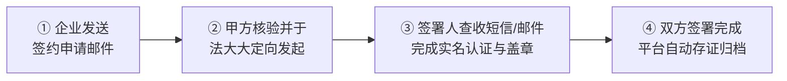

# 千年鹿 · 认知结构工程（Cognitive Structure Engineering）

> **从「堆参数」到「建结构」——通过结构化工程应对大模型幻觉问题的探索性研究。**

## ——官方正式合同文本与签约操作指引档案库

**文件版本**：v1.1（正式签约版）  
**定稿发布时间**：2026 年 11 月 17 日  
**定向签约通道**：已正式开启（意向企业邮件提交信息，甲方定向发起法大大签约）  
**正式发售与对公打款**：2026 年 11 月 18 日 0 时（周三，北京时间 UTC+8）  
**发 布 方**：千年鹿™️（QNLOO™️）物理真诚™️（PHYSICAL SINCERITY™️）  
**收 款 方**：厦门千年鹿文化科技有限公司  
**官方指定邮箱**：ip@qnloo.com  

---

> **宇宙负熵，物理真诚。鹿出东方，大道启程。**

---

## 项目简介

认知结构工程是千年鹿（QNLOO）在人工智能可靠性方向的探索性研究，主张以结构化工程而非单纯堆叠参数的方式，应对大模型幻觉问题。该架构方向从千年鹿认知体系的底层公理严谨推导，并已在主权 AI IDE「鹿角（LOOJIO）」的工程实践中获得初步验证。

需要明确声明：本项目当前成果属于**探索性、方向性研究**，旨在指出解决问题的理论与架构方向，不代表该方向已完全实现，亦不承诺对具体应用场景的实施效果。

---

## 三级产品体系

认知结构工程按「方向 — 方法 — 实现」分为三级产品，**本阶段仅授权第一级白皮书，不包含专利许可与源码授权**：

| 级别 | 定位 | 内容要点 | 官方定价 | 名额与规则说明 |
| :--- | :--- | :--- | :--- | :--- |
| **白皮书** | **方向** | 理论框架与架构方向（含 23 个不等式展示） | **20 万元** | 30 天发售窗口期。首日特设 1~35 席**首发特权价锁定**，并在第二阶段拟开放的专利名额、源码名额中享有优先选择顺位，不受后续市场重估影响；第 36 席及以后首日付清者享**窗口期早鸟价锁定** |
| **专利许可** | **方法** | 具体方法与技术方案专利非独占许可 | **180 万元** | 拟开放 20 个名额，需先认购白皮书，依白皮书到账排位享有优先选择权 |
| **源码授权** | **实现** | 可运行的工程实现（鹿角稳定版本） | **800 万元** | 拟开放 5 个名额，需先获得专利许可，不得跨级跳购 |

---

## 官方出版级交付件

> 支持在线纯文本阅读与出版级矢量 PDF 下载。建议意向企业的技术团队、法务及财务部门联合查阅。

| 交付文件 | 出版级 PDF | 在线纯文本 (MD) | 文件说明 |
| :--- | :--- | :--- | :--- |
| **《认知结构工程白皮书授权使用合同》** | [下载 PDF](./合同/认知结构工程白皮书授权使用合同.pdf) | [阅读 MD](./合同/认知结构工程白皮书授权使用合同.md) | 官方正式授权合同，载明标的、权责、全款/定金双池排位、价格锁定与免责条款 |
| **《认知结构工程白皮书认购与签署操作指引》** | [下载 PDF](./合同/白皮书认购与签署操作指引.pdf) | [阅读 MD](./合同/白皮书认购与签署操作指引.md) | 签约与打款实操指引，含时间表、收款账户、法大大定向签约及名额排位规则 |

---

## 关键时间节点

| 阶段 | 时间安排 | 事项与操作说明 |
| :--- | :--- | :--- |
| **定稿发布** | 2026 年 11 月 16 日（周一） | 吸收业界合规反馈后正式定稿合同与操作指引，配置法大大国家 CA 电子签章模板 |
| **定向签约通道开启** | 2026 年 11 月 16 日至 12 月 17 日 | 意向企业邮件提交签约主体及签署人信息，甲方通过法大大定向发起合规电子签约（**签署时间不作为排序依据**，用于提前完成企业法务/财务内审） |
| **发售开闸与对公打款** | 2026 年 11 月 18 日 0 时（周三） | 白皮书正式发售窗口期开启，银行对公打款，**严格按银行到账时间戳确定顺位** |
| **首日截止与序列号生成** | 2026 年 11 月 18 日 24:00 | 首日截止，合并生成 1~35 席首发特权价名额及窗口期早鸟价名额序列号 |
| **资质审核与名额告知** | 收到款项后 3 个工作日内 | 审核企业工商、社保缴纳及信用记录，通过官方邮件反馈到账及序列号（设反向催问防线） |
| **交付与回执闭环** | 款项付清且资质通过后 3 个工作日内 | 电子交付白皮书（含 23 个不等式展示）及开源白盒实证材料，执行推定送达机制 |
| **发票开具** | 收到相应款项后 30 日内 | 甲方（增值税小规模纳税人）按规定开具合法有效增值税发票 |

---

## 法大大线上签约申请指引（定向发起机制）

> [!NOTE]
> **为什么需要定向发起签约？**  
> 为确保电子签约完全具备《中华人民共和国民法典》及《中华人民共和国电子签名法》规定的法定证据效力，本合同采用**法大大（Fadada）国家 CA 认证**可靠电子印章系统。该系统不支持匿名或无指定主体的公开自助签章，须由**甲方在法大大系统内针对贵司专属定向发起**签署任务。

### 签约办理四步流程：



#### 第一步：发送签约申请邮件至官方邮箱
意向企业请指派法定代表人或授权签署代表，向官方唯一指定邮箱 [`ip@qnloo.com`](mailto:ip@qnloo.com) 发送签约申请邮件。

**邮件主题格式**：  
`【白皮书签约申请】- [贵司企业全称] - 签署代表姓名`

**邮件正文请复制并填写以下信息**：
```text
【白皮书电子签约申请信息】
1. 企业全称：[请填写与营业执照一致的企业全称]
2. 统一社会信用代码：[18 位统一社会信用代码]
3. 注册地址 / 住所：[营业执照登记地址]
4. 法定代表人姓名：[法定代表人姓名]
5. 本次签署代表姓名：[法定代表人本人 或 授权签约代表姓名]
6. 签署代表手机号码：[用于接收法大大签约短信通知及核验验证码，请务必准确]
7. 签署代表电子邮箱：[用于接收法大大签约链接及归档存证报告]
8. 拟选择付款方式：[全款 20 万元 / 定金 2 万元]
```

#### 第二步：查收法大大签约链接
甲方收到邮件核对无误后，将在法大大系统内配置专属合同并向上述签署代表手机/邮箱定向发起签署。签署代表的手机将收到署名为**【法大大】**的官方短信通知，内含安全签约短链。

#### 第三步：在线完成身份核验与电子签章
签署人点击链接进入法大大官方平台，完成个人实名认证及企业授权核验后，加盖企业电子公章及个人签名。

#### 第四步：存证归档
双方签署完成后，法大大平台将自动合成具备司法存证效力的电子签名报告（含国家授时中心时间戳与 CA 证书），双方均可随时在线下载 PDF 原件归档。

> [!IMPORTANT]
> **关于签约与排位的边界声明**：  
> 1. **签约不占坑**：仅完成电子签约未在发售窗口期内实际支付对应款项的，不取得名额、顺位及第二阶段优先认购权益，合同签署时间**绝不作为排序依据**；提前签约仅用于扫清企业法务与财务打款前置内审；  
> 2. **排序唯一客观标准**：名额归属与顺位排序，**唯一以 2026 年 11 月 18 日 0 时起交通银行官方对公账户实际到账时间戳为准**。

---

## 收款方主体与官方对公账户

> **重要提示**：请认准唯一官方指定收款账户，请勿向任何未在本档案库载明的账户付款。

- **企业名称**：厦门千年鹿文化科技有限公司
- **统一社会信用代码**：91350206MAC8JG9U60
- **住所地址**：厦门火炬高新区创业园火炬东路 11 号创业大厦第二层 222 室-3
- **增值税纳税人身份**：增值税小规模纳税人
- **官方指定沟通与接收邮箱**：`ip@qnloo.com`

**官方对公收款银行账户**：

| 项目 | 官方信息 |
| :--- | :--- |
| **账户名称** | 厦门千年鹿文化科技有限公司 |
| **开户银行** | 交通银行股份有限公司厦门松柏支行 |
| **银行账号** | 352000669013001165702 |

---

## 付款方式与操作规范

自 2026 年 11 月 18 日 0 时发售开闸起（发售窗口期 30 天，到期窗口关闭即停止发售），意向企业可通过对公转账选择以下任一方式付款：

1. **全款方式**：一次性支付人民币 200,000 元（大写：人民币贰拾万元整）；
2. **定金方式**：先支付定金人民币 20,000 元（大写：人民币贰万元整，占合同总价 10%，符合《中华人民共和国民法典》第五百八十六条规定），资质审核通过后 3 个工作日内补齐尾款人民币 180,000 元。

> [!WARNING]
> **定金性质与罚则声明**：  
> 乙方支付的定金具有担保签约履约及保留顺位之性质。乙方提供虚假信息、伪造资质，或资质审核通过后逾期未补齐尾款、主动弃购的，定金不予退还，用以补偿甲方顺位锁定、资质核验及机会成本损失，顺位依序递补。

---

## 四大重要边界（底线声明）

1. **探索性成果，不承诺具体效果**：白皮书为探索性、方向性研究资料，「相信」不等于「保证」，不构成对任何技术效果或具体场景实施结果的承诺，不对买方商业收益承担责任；
2. **资质限定中国境内合法企业**：全部授权仅面向在中华人民共和国境内合法注册满 12 个月、正常缴纳社保、无严重失信记录的企业，严禁代境外主体持有或间接获取；
3. **数字资产交付即履行完毕**：白皮书为数字知识资产，以发件方发送时间戳为准交付即完成，除合同另有约定外不支持无理由退款；
4. **先发保护与最终开源普惠**：白皮书销售截止之日起设 3～6 个月先发保护期，保障首批买方先发权益；保护期届满后甲方将启动开源流程，最终成果面向全社会普惠。

---

## 核心商业与法务规则摘要

### 1. 认知规律与三级产品递进（非无理捆绑）
认知结构工程按“方向—方法—实现”分为三级产品。双方确认，第二阶段采购层层递进（购买源码须先获专利，获专利须先购白皮书），系基于前沿技术的客观认知规律：乙方先研读白皮书及实证，再判断是否购买专利；取得专利并深入分析后，再决定是否购买源码；该顺序旨在保护乙方决策、避免盲目投资，而非无理捆绑。

### 2. 双池排序、定金罚则与秒级到账时间戳
发售首日的名额及顺位，按甲方对公账户实际到账时间戳确定：
- **全款池优先于定金池**：首日付清全款的企业，顺位优先于首日支付定金的企业；同一池内按实际到账时间戳先后排序；
- 首日 24:00 截止后合并生成序列号：第 1 至 35 号为**首发特权价名额**（并在第二阶段拟开放的专利名额、源码名额中享有优先选择顺位，不受后续市场重估影响）；第 36 号及以后首日付清者为**窗口期早鸟价名额**（享第二阶段早鸟特惠锁定）；
- 提前签署合同不提前取得名额或顺位，银行实际到账时间戳为唯一客观依据。

### 3. 集团内签约主体单向向上变更机制
为兼顾大厂子公司低调安排与合规承接需求，同时防范黄牛倒买倒卖：
- 允许企业集团旗下子公司在第一阶段以自身名义签约，进入第二阶段时**单向向上变更为母公司**承接，继承既有名额顺位与价格锁定；
- **仅限向上变更，不允许向下、向平级关联方或任何第三方流转**。

### 4. 数字指纹溯源阶梯举证防线
甲方有权在交付的数字版授权文件中设置对应乙方的专有数字溯源标识（含特定文本特征或识别码），作为防扩散与泄密判定的初步事实证据；若在非授权渠道发现带有该专属标识的授权内容，乙方应配合核查并作出合理解释，无法合理解释且无法证明泄露非己方原因的，依法承担违约责任。

### 5. 税票开具与小规模纳税人说明
甲方目前为增值税小规模纳税人，甲方在收到相应款项后 30 日内，按国家现行税收政策开具对应税率的增值税发票。乙方因自身财务要求需特定类型或税率发票的，应在付款前与甲方沟通确认，甲方不承担因税率差异导致的补偿责任。

---

## 关联发布档案与背景导读 (03-1)

如需全面了解白皮书理论预告、序章参考等，请查阅前序发布仓库：

- **前序发布仓库**：[`03-1-cognitive-structure-engineering`](https://github.com/QNLOO/03-1-cognitive-structure-engineering)（[Hugging Face 数据集镜像](https://huggingface.co/datasets/QNLOO/03-1-cognitive-structure-engineering)）
- **《千年鹿 · 认知结构工程 · 发布预告（v1.3）》**：深入阐释结构约束逻辑及首日 35 席首发特权锁定权益
- **《认知结构工程 · 序章 - 从汽油到发动机》**：白皮书公开发布序章全文，建议技术决策层与法务联合研读

---

## 关注后续更新与动态订阅

为了确保及时获取最新排位结果公示与白皮书交付动态，请持续关注本官方档案库：

1. **关注官方仓库**：
   - **GitHub 官方仓库**：[`QNLOO/03-2-cognitive-structure-engineering-contracts`](https://github.com/QNLOO/03-2-cognitive-structure-engineering-contracts)
   - **Hugging Face 官方数据集**：[`QNLOO/03-2-cognitive-structure-engineering-contracts`](https://huggingface.co/datasets/QNLOO/03-2-cognitive-structure-engineering-contracts)
2. **官方履约时间点**：
   - **11 月 18 日 0 时**：对公发售正式开闸，接受全款与定金转账；
   - **11 月 18 日 24:00 后**：依法依规核验到账时间戳，生成 1~35 席首发特权价及窗口期早鸟价序列号，并通过官方邮件向买方反馈。

---

## 官方沟通与签约咨询

- **官方指定邮箱**：[`ip@qnloo.com`](mailto:ip@qnloo.com)
- **邮件主题规范**：
  - 电子签约申请：`【白皮书签约申请】- [贵司全称] - 签署代表姓名`
  - 商务/法务咨询：`【白皮书商务咨询】- [贵司全称] - 联系人/职务`
